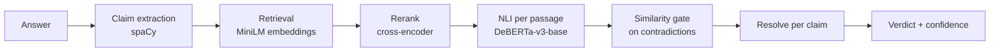

# HalluciGuard 2.0

[](https://github.com/Devarsh-04/halluci-guard-nlp/actions/workflows/ci.yml)
[](LICENSE)

Checks whether each claim in an LLM answer is supported, contradicted, or unaddressed by evidence passages you supply, and returns a per-claim, per-passage verdict with scores.


Status: local prototype. It verifies against evidence you provide, or against passages it retrieves from a corpus you point it at.

## Problem

LLMs produce fluent answers that contain claims nothing supports. A reader cannot tell which sentences to trust.

## Why retrieval alone is not enough

Retrieval-augmented generation puts relevant text in the prompt, but nothing checks that each generated statement follows from it. Topically similar text is not the same as text that entails a claim. HalluciGuard adds that check after generation.

## Pipeline



1. Split the answer into atomic claims (`pipeline.py`, `extract_claims`).
2. Rank the supplied passages for each claim with embeddings, then a cross-encoder.
3. Run NLI (entailment / contradiction / neutral) on each claim-passage pair.
4. Passage verdict: `SUPPORTED` if entailment is the top label; `CONTRADICTED` if contradiction is the top label at 0.6 or more and the passage is at least 0.5 similar to the claim (MiniLM cosine); otherwise `INSUFFICIENT_EVIDENCE`.
5. Claim verdict: supported and contradicted passages yield `CONFLICTING_EVIDENCE` only when both sides reach 0.95 confidence; otherwise the stronger side wins.
6. The answer verdict aggregates its claims.

Source authority is never assessed. `confidence` on a `SUPPORTED` or `CONTRADICTED` claim is a temperature-scaled NLI probability (T = 2.6, fitted on the SciFact train split); the other scores are uncalibrated research scores. Calibration was checked on SciFact only.

## Run it

```bash
python3 -m venv .venv && .venv/bin/pip install -r requirements-api.txt
.venv/bin/uvicorn api:app --port 8000
```

Open http://127.0.0.1:8000 for the UI, or `POST /api/v1/verify` (schema at `/docs`). `GET /health` checks the server.

```bash
HALLUCIGUARD_RUN_MODEL_TESTS=1 .venv/bin/pytest -q
```

The model tests need the models cached locally. Without them, a plain `pytest -q` skips those 12 tests, which is what CI runs.

Docker (CPU, models baked into the image at build time):

```bash
docker build -t halluciguard .
docker run -p 8000:8000 halluciguard
```

## Evidence search

`POST /api/v1/verify-search` takes only `question` and `answer`, finds its own evidence, and verifies against it (`search.py`). It is off until you set `HALLUCIGUARD_CORPUS` to a SciFact-format `corpus.jsonl` (`doc_id`, `title`, `abstract` as a list of sentences); the Docker image does not include a corpus.

```bash
HALLUCIGUARD_CORPUS=/path/to/corpus.jsonl .venv/bin/uvicorn api:app --port 8000
```

Per claim, the loop is:

1. Take the 15 closest two-sentence windows by MiniLM similarity, rerank them with the cross-encoder, and run NLI on the 5 most relevant (NLI on all 15 gave the same dev result at three times the cost).
2. In this retrieved-evidence mode the verdict rules are stricter than for evidence you supply, because retrieved passages are often only loosely related. A contradiction needs NLI probability of 0.95 or more, similarity to the claim of 0.6 or more and a cross-encoder relevance score of 4 or more (or NLI probability of 0.999 with similarity 0.5 and relevance 3); a support needs a relevance score of -2 or more. The most relevant passage with a committed verdict decides, and `CONFLICTING_EVIDENCE` needs that passage and a relevant opposing passage to both reach 0.99.
3. Stop if the verdict is `SUPPORTED` or `CONTRADICTED` with raw NLI probability of 0.9 or more, or if the evidence conflicts.
4. Retries are off by default. With `max_retries` set to 1 or 2 in the request, an unconvinced claim fetches the next 15 passages and is verified against all passages so far. Measured under these rules they do not help (see the table), so leave them off.

Each claim in the response carries a `search` trace: rounds used, passages searched, and why it stopped. There is no LLM and no query rewriting; a retry only looks deeper in the same ranking. The index (about 40,000 passages for SciFact) is built at server startup, which takes a few minutes on CPU the first time, and is cached next to the corpus so later starts are fast.

The rules were chosen on the train split from 15-passage features cached by `experiments/open_features.py` and swept by `experiments/open_rules.py`. On train, accuracy went from 56.2% to 63.9% and false refutes from 132 to 19.

Open-corpus results on the SciFact dev split (300 claims; `python -m experiments.tune_scifact retrieval`), against the oracle result below:

| Evidence | Accuracy | Macro F1 | Supported recall | Contradicted recall | False support | False refute | Conflicts | Seconds per claim |
|---|---:|---:|---:|---:|---:|---:|---:|---:|
| Oracle rationale sentences | 64.3% | 0.631 | 41.1% | 56.2% | 4 | 14 | 1 | n/a |
| Retrieved, rules for supplied evidence (first version) | 55.3% | 0.558 | 37.9% | 67.2% | 6 | 52 | 11 | 0.65 |
| Retrieved, relevance-gated rules, 15 passages assessed | 60.0% | 0.567 | 46.8% | 34.4% | 13 | 12 | 3 | 2.13 |
| Retrieved, relevance-gated rules, top 5 assessed, two-tier gate (**current default**) | 60.3% | 0.576 | 46.8% | 37.5% | 13 | 13 | 3 | 0.63 |
| Retrieved, relevance-gated rules, 15 passages assessed, 2 retries | 59.3% | 0.562 | 48.4% | 34.4% | 18 | 13 | 3 | 7.27 |

The gold document is among the top 5 passages for 85.1% of the 188 labeled dev claims, the top 10 for 91.5% and the top 15 for 95.2%.

What this shows:

- Retrieval was not the main bottleneck. The drop from oracle evidence came from verifying against off-point passages, which produced 52 false refutes and 11 conflicts. Gating on cross-encoder relevance and letting the most relevant passage decide cut false refutes to 12, the same as with oracle evidence, and conflicts to 3.
- The price is contradicted recall, which fell from 67.2% to 34.4%. Macro F1 barely moved (0.558 to 0.567); accuracy rose 4.7 points, mostly from fewer false refutes. This is a precision-first setting and it is not a free win.
- Supported recall rose (37.9% to 46.8%) and false supports rose from 6 to 13.
- Assessing only the top 5 passages brought the time back to 0.63 s per claim, from 2.13 s with 15, at equal or slightly better accuracy and contradicted recall (37.5% against 34.4%, helped by the second route for very confident contradictions). The 2-retry row was measured before that change and is not directly comparable.
- Retries do not pay for themselves: with 2 retries (measured with 15 passages assessed) the loop averaged 2.32 rounds per claim and took 7.3 s per claim, for slightly lower accuracy (59.3% against 60.0%), no change in contradicted recall and more false supports (18 against 13). Supported recall rose by 1.6 points.
- Claims with no gold evidence still receive retrieved passages, so abstaining correctly is harder than in the oracle setting.

## Evaluation: SciFact

Setup: SciFact claims with oracle evidence (annotated rationale sentences, or the cited abstracts when a claim has no annotated evidence). This measures verification only, not retrieval, and SciFact is scientific text. Labels: Support, Contradict, no evidence. The development split has no claims with both support and refute labels, so every conflict output on it is a false conflict.

Rules and thresholds were chosen on the train split (809 claims) and then checked on dev (300 claims). Dev was looked at once per candidate change, so treat later rows as slightly optimistic. `experiments/tune_scifact.py` reproduces the numbers (set `SCIFACT_DIR` to a folder holding the SciFact release's `claims_train.jsonl`, `claims_dev.jsonl` and `corpus.jsonl`); `python -m experiments.tune_scifact ablation` prints the ablation table.

| Version | Dev accuracy | Dev macro F1 | Dev supported recall | Dev contradicted recall |
|---|---:|---:|---:|---:|
| First prototype (small NLI) | 49.3% | 0.442 | 18.5% | 32.8% |
| Rules tuned on train (small NLI) | 55.3% | 0.513 | 33.9% | 32.8% |
| Similarity gate instead of entity gate (small NLI) | 59.7% | 0.575 | 33.9% | 48.4% |
| Larger NLI model | 64.3% | 0.635 | 41.1% | 56.2% |
| Conflicts need a relevant opposing passage (**current**) | 64.3% | 0.631 | 41.1% | 56.2% |

Rows after the first replay the decision rules over cached model outputs, which skips the claim extractor (it splits 4 of 300 dev claims).

### Ablation

All rows use the current DeBERTa-v3-base model. Each row adds one rule to the one above it, except the last two, which are the earlier prototype's rules.

| Configuration | Split | Accuracy | Macro F1 | Supported recall | Contradicted recall | False support | False refute | Conflicts |
|---|---|---:|---:|---:|---:|---:|---:|---:|
| NLI argmax only | train | 64.9% | 0.649 | 40.7% | 69.4% | 14 | 53 | 10 |
| NLI argmax only | dev | 66.3% | 0.669 | 40.3% | 73.4% | 3 | 16 | 5 |
| + conflict margin 0.95 | train | 65.1% | 0.651 | 40.7% | 70.5% | 14 | 54 | 7 |
| + conflict margin 0.95 | dev | 66.7% | 0.669 | 41.1% | 73.4% | 3 | 17 | 3 |
| + contradiction >= 0.6 | train | 64.9% | 0.648 | 40.7% | 69.4% | 14 | 53 | 7 |
| + contradiction >= 0.6 | dev | 66.7% | 0.669 | 41.1% | 73.4% | 3 | 17 | 3 |
| + entity gate on refutes | train | 61.3% | 0.596 | 40.7% | 45.1% | 15 | 25 | 7 |
| + entity gate on refutes | dev | 61.7% | 0.596 | 41.1% | 42.2% | 3 | 8 | 3 |
| + similarity gate >= 0.5 on refutes instead | train | 64.5% | 0.643 | 41.0% | 60.7% | 16 | 30 | 5 |
| + similarity gate >= 0.5 on refutes instead | dev | 64.3% | 0.635 | 41.1% | 56.2% | 4 | 12 | 3 |
| + conflict needs a relevant opposing passage (**current**) | train | 64.9% | 0.646 | 41.3% | 61.8% | 16 | 31 | 1 |
| + conflict needs a relevant opposing passage (**current**) | dev | 64.3% | 0.631 | 41.1% | 56.2% | 4 | 14 | 1 |
| + entity gate on supports | train | 56.4% | 0.540 | 26.5% | 45.7% | 7 | 25 | 6 |
| + entity gate on supports | dev | 55.0% | 0.523 | 25.0% | 42.2% | 2 | 8 | 3 |
| + entailment >= 0.6 and combined >= 0.6 (previous) | train | 56.0% | 0.534 | 25.6% | 45.1% | 6 | 25 | 7 |
| + entailment >= 0.6 and combined >= 0.6 (previous) | dev | 54.7% | 0.519 | 24.2% | 42.2% | 2 | 8 | 4 |

Things this table shows:

- Raw NLI is strong with the base model (dev accuracy 66.7%, macro F1 0.669 once the 0.6 contradiction threshold and conflict margin are added). The current configuration gives some of that up on purpose: the similarity gate on refutes cuts contradicted recall (73.4% to 56.2% on dev) to cut false refutations (17 to 12 on dev, 53 to 30 on train), because wrongly calling a true claim false is the costlier error here. If recall matters more, drop the gate.
- The similarity gate beats the named-entity gate on recall: 56.2% against 42.2% contradicted recall on dev, at the price of a few more false refutes (12 against 8 on dev, 30 against 25 on train). The entity gate also misses contradictions that swap in a different entity, which the conflict set below exposes.
- Requiring a relevant opposing passage for a conflict (cross-encoder score of 4 or more) cuts false conflicts on single-label claims from 5 to 1 on train and 3 to 1 on dev. It also moved a couple of those claims to false refutes on dev (12 to 14), so the net accuracy effect is about zero.
- The combined (NER + embedding + NLI) score and a gate on supports are what suppressed correct support verdicts in the first prototype (supported recall 41.1% down to about 25%).
- Model size: the base model beats the small one with identical rules (dev accuracy 64.3% against 59.7%, contradicted recall 56.2% against 48.4%, false refutes 12 against 15). It is about twice as slow (see Latency) and somewhat larger.

I also tried a lower similarity gate (0.3) with a stricter contradiction threshold (0.9) because it scored higher on train. It fails the conflict set: unrelated passages get called contradictions and unrelated passages produce false conflicts. That is why the gate stays at 0.5.

### Reranker

With oracle evidence the reranker only reorders passages, so the ablation cannot show it. `python -m experiments.rerank_eval` measures it on retrieval instead: for each labeled claim, 30 candidate passages from the bi-encoder, then reranked by the cross-encoder. A hit means a passage from a gold document is in the top k.

| Split | Labeled claims | Ranking | Hit@1 | Hit@3 | Hit@5 | Hit@10 | MRR |
|---|---:|---|---:|---:|---:|---:|---:|
| dev | 188 | bi-encoder | 69.7% | 82.4% | 85.1% | 91.5% | 0.772 |
| dev | 188 | bi-encoder + reranker | 76.6% | 88.3% | 90.4% | 94.7% | 0.825 |
| train | 505 | bi-encoder | 72.1% | 84.2% | 87.3% | 92.7% | 0.789 |
| train | 505 | bi-encoder + reranker | 78.8% | 89.1% | 92.7% | 94.9% | 0.844 |

The reranker improves retrieval on both splits. Evidence search uses its scores to order passages and to gate verdicts by relevance, which is what cut the false refutes; see the open-corpus table under Evidence search.

### Conflict sets

SciFact cannot measure conflict detection, so two hand-written sets cover it. Each has 40 items, 10 each of: a claim with one supporting and one refuting passage (gold conflict), supported, contradicted, and no evidence. `python -m experiments.conflict_eval` runs the first and `python -m experiments.conflict_eval conflict_set_hard` the second.

- `experiments/conflict_set.jsonl`: unrelated distractor passages.
- `experiments/conflict_set_hard.jsonl`: distractors are about the same entity or topic ("Marie Curie won two Nobel Prizes" with a passage about her birthplace; "Water boils at 100 degrees Celsius" with a passage about boiling at altitude), which is where NLI makes mistakes.

| Set | Accuracy | Conflict precision | Conflict recall | Supported recall | Contradicted recall |
|---|---:|---:|---:|---:|---:|
| Unrelated distractors | 97.5% | 9/9 | 9/10 | 100% | 100% |
| Same-topic distractors | 90.0% | 9/9 | 9/10 | 80% | 90% |

Before the conflict-relevance rule the same-topic set scored 85% (four false conflicts on supported claims) and the unrelated-distractor set 100%. The rule fixed the false conflicts and lost one real conflict whose refuting passage scored 3.7 on relevance ("The Pacific Ocean is smaller than the Atlantic Ocean"). The remaining same-topic errors are NLI contradictions between passages about different conditions ("A fish heart has two chambers" against "the human heart has four").

Treat both as sanity checks, not benchmarks: they are small, written by the author, and the thresholds were examined against them. The first set also caught a real flaw earlier: the named-entity gate discarded contradictions that swap in a different entity.

### Calibration

`confidence` on a committed verdict is the NLI probability after temperature scaling (T = 2.6, fitted on train). Dev accuracy of committed `SUPPORTED` / `CONTRADICTED` verdicts by confidence (105 verdicts; `python -m experiments.tune_scifact calibration`); abstentions and conflicts are excluded.

Raw probabilities (T = 1):

| Confidence | Claims | Mean confidence | Accuracy |
|---|---:|---:|---:|
| 0.50-0.70 | 4 | 0.622 | 75.0% |
| 0.70-0.90 | 7 | 0.793 | 71.4% |
| 0.90-0.99 | 25 | 0.966 | 84.0% |
| 0.99-1.00 | 69 | 0.998 | 84.1% |

Expected calibration error 0.143. Raw probabilities are overconfident: verdicts at 0.97 are right about 84% of the time.

Temperature scaled (T = 2.6):

| Confidence | Claims | Mean confidence | Accuracy |
|---|---:|---:|---:|
| 0.00-0.50 | 1 | 0.465 | 0.0% |
| 0.50-0.70 | 14 | 0.596 | 85.7% |
| 0.70-0.90 | 59 | 0.837 | 79.7% |
| 0.90-0.99 | 31 | 0.938 | 90.3% |

Expected calibration error 0.072 on dev (0.022 on train). Two cautions: the dev bins are small, and the temperature was fitted on SciFact, so it says nothing about other domains. The verdict thresholds (0.6 contradiction, 0.95 conflict, 0.9 search stop) still act on raw probabilities.

### Latency

One request, after warm-up, CPU only (Apple M3), 30 SciFact dev claims with sentence-length passages (`python -m experiments.tune_scifact latency`). Model load takes about 5 s on first use. The previous small NLI model took 131 ms, 380 ms and 750 ms at these sizes.

| Passages | p50 | p95 |
|---:|---:|---:|
| 3 | 229 ms | 260 ms |
| 10 | 669 ms | 794 ms |
| 20 (API maximum) | 1453 ms | 1880 ms |

Cost grows with the passage count because NLI runs on every claim-passage pair; this is the supplied-evidence path (search mode assesses at most 5 passages per round). There is no LLM API call, so there is no per-request API cost.

### Domain check: visa pairs from v5

The v5 coursework data was extracted from the notebooks into `experiments/visa_v5/`: 120 Australian visa knowledge-base passages and 120 source/answer pairs (60 grounded, 60 hallucinated: numerical changes, semantic changes, paraphrases and so on). `python -m experiments.visa_eval` runs 2.0 on them. A pair counts as "flagged" when the verdict is anything other than `SUPPORTED`.

| Evidence | Accuracy | Hallucination precision | Hallucination recall | Grounded answers wrongly flagged |
|---|---:|---:|---:|---:|
| The pair's own source passage | 97.5% | 96.7% | 98.3% | 2 of 60 |
| Retrieved from the 120-passage knowledge base | 85.8% | 78.7% | 98.3% | 16 of 60 |

With its source passage, 2.0 caught 29 of 30 numerical and 26 of 26 semantic hallucinations. The retrieval row is lower (it was 73.3% with the first search rules, before relevance gating), but read it carefully: the pairs' source sentences are short paraphrases, not the knowledge-base text, so a grounded answer is often not fully covered by what retrieval finds. That row measures knowledge-base coverage as much as verification.

Treat all of this as a smoke test. The pairs are synthetic, written by the v5 authors, and they are small; the knowledge base is not authoritative, dated or checked against Home Affairs. Nothing here shows the system is safe for real visa questions. That needs a real, dated corpus and an expert-labelled evaluation set.

## Failure modes

| Failure mode | Evidence | Mitigation | Status |
|---|---|---|---|
| Too many abstentions: correct entailments labelled insufficient | First prototype labelled 88 of 124 supported dev claims insufficient | Removed the combined-score gate and the gate on supports | Supported recall 18.5% to 41.1%; still low |
| False conflicts: one weak opposing passage forces a conflict | 5 false conflicts on dev, 11 on train, for claims with a single gold label; 4 false conflicts on the same-topic conflict set | Conflict needs both sides at 0.95 or more, and the opposing passage must be relevant (cross-encoder score of 4 or more) | 1 on dev and 1 on train with supplied evidence, 3 in search mode; same-topic set 90% |
| Wrongly refuting a true claim | 53 train false refutes with raw NLI; 132 train false refutes in search mode | A contradiction needs similarity of 0.5 or more (0.6, NLI 0.95 and a relevance score of 4 in search mode) | Train false refutes 30 (supplied evidence) and 19 (search); costs contradicted recall |
| Agent keeps searching without converging | Mean 2.32 rounds per claim with 2 retries, 7.3 s per claim | Retry budget (default 0, maximum 2) and a 0.9 confidence stop | Bounded, but retries gave no accuracy gain (59.3% against 60.0%) and added false supports, so they are off by default |
| Topically similar but non-entailing evidence | Retrieval finds the right document 85% of the time (top 5); with the first rules, open-corpus false refutes were 52 against 12 with oracle evidence | Cross-encoder relevance gate, top-passage voting and top-5 assessment in search mode | Mitigated: false refutes 13 on dev, at the cost of contradicted recall (37.5%) |
| Passage too long for the NLI model | Inputs over 512 tokens | Request is rejected with a clear error | Caller must shorten passages |
| Entity swapped into the claim | Earlier entity gate dropped 3 of 10 conflict-set contradictions | Replaced by the similarity gate | Fixed on the conflict set |
| Text outside the evaluated domain | Tested on science (SciFact) and a small synthetic visa set only | None | Open: no real visa corpus or expert-labelled set exists here |

## Limitations

- Search works over a local SciFact-format corpus only. There is no web search, no LLM and no query rewriting, so the retry loop is a deeper look in one ranking and not reasoning. With retrieved evidence, accuracy falls from 64.3% to 60.3% on SciFact dev.
- Search mode is precision-first: contradicted recall is 37.5% on dev (56.2% with supplied evidence).
- Quantitative results are SciFact (scientific text) plus two 40-item hand-written conflict sets and 120 synthetic visa pairs. There is no real visa corpus and no expert-labelled evaluation set.
- NLI contradictions between passages about different conditions still cause some false refutes and false conflicts (see the same-topic conflict set).
- Confidence is calibrated on SciFact only; the verdict thresholds still use raw probabilities.
- Latency is from one machine with short passages (1.4 s at the 20-passage API maximum for supplied evidence).
- Dev was used to check each candidate change, so later numbers are slightly optimistic. The conflict sets were examined while tuning.

## Next steps

- A real, dated visa corpus from authoritative sources and an expert-labelled evaluation set, before any claim about that domain. This is the biggest gap and needs people and data, not code.
- Fine-tune the NLI model on in-domain data to cut the contradictions between passages about different conditions; I did not try this because it needs labelled domain data and CPU training time.
- Move the verdict thresholds onto the calibrated probabilities (not done: it would change behaviour without a measured gain).
- Recover more contradicted recall in search mode without bringing the false refutes back.

## Background: HalluciGuard v5 (coursework)

The repository began as an NLP assessment at the University of Technology Sydney: a retrieval-augmented pipeline for Australian visa questions (SBERT + FAISS retrieval, cross-encoder reranking, Flan-T5-base generation, NLI/NER/embedding verification) evaluated on 120 curated passages and 120 synthetic hallucination pairs. Its notebooks are `HalluciGuard_v5_RESEARCH_FINAL.ipynb` and related files. The reported v5 weighted F1 of 1.00 for NLI and for the full pipeline was measured on that small synthetic set and should not be read as general performance.

Team: Devarsh Varma, Agharn Singh Marjara.

This is research code, not legal or immigration advice.
