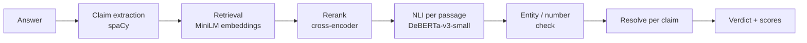

# HalluciGuard 2.0

[](https://github.com/Devarsh-04/halluci-guard-nlp/actions/workflows/ci.yml)
[](LICENSE)

Checks whether each claim in an LLM answer is supported, contradicted, or unaddressed by evidence passages you supply, and returns a per-claim, per-passage verdict with scores.


Status: local prototype. It verifies against evidence you provide, or against passages it retrieves from a corpus you point it at.

## Problem

LLMs produce fluent answers that contain claims nothing supports. A reader cannot tell which sentences to trust.

## Why retrieval alone is not enough

Retrieval-augmented generation puts relevant text in the prompt, but nothing checks that each generated statement follows from it. Topically similar text is not the same as text that entails a claim. HalluciGuard adds that check after generation.

## Pipeline



1. Split the answer into atomic claims (`pipeline.py`, `extract_claims`).
2. Rank the supplied passages for each claim with embeddings, then a cross-encoder.
3. Run NLI (entailment / contradiction / neutral) on each claim-passage pair.
4. Passage verdict: `SUPPORTED` if entailment is the top label; `CONTRADICTED` if contradiction is the top label at 0.6 or more and the passage shares a named entity with the claim; otherwise `INSUFFICIENT_EVIDENCE`.
5. Claim verdict: supported and contradicted passages yield `CONFLICTING_EVIDENCE` only when both sides reach 0.95 confidence; otherwise the stronger side wins.
6. The answer verdict aggregates its claims.

Source authority is never assessed. Scores are research scores, not calibrated confidence.

## Run it

```bash
python3 -m venv .venv && .venv/bin/pip install -r requirements-api.txt
.venv/bin/uvicorn api:app --port 8000
```

Open http://127.0.0.1:8000 for the UI, or `POST /api/v1/verify` (schema at `/docs`). `GET /health` checks the server.

```bash
HALLUCIGUARD_RUN_MODEL_TESTS=1 .venv/bin/pytest -q
```

The model tests need the models cached locally. Without them, a plain `pytest -q` skips those 12 tests, which is what CI runs.

Docker (CPU, models baked into the image at build time):

```bash
docker build -t halluciguard .
docker run -p 8000:8000 halluciguard
```

## Evidence search

`POST /api/v1/verify-search` takes only `question` and `answer`, finds its own evidence, and verifies against it (`search.py`). It is off until you set `HALLUCIGUARD_CORPUS` to a SciFact-format `corpus.jsonl` (`doc_id`, `title`, `abstract` as a list of sentences); the Docker image does not include a corpus.

```bash
HALLUCIGUARD_CORPUS=/path/to/corpus.jsonl .venv/bin/uvicorn api:app --port 8000
```

Per claim, the loop is:

1. Retrieve the 5 best two-sentence windows by MiniLM similarity and verify the claim against them.
2. Stop if the verdict is `SUPPORTED` or `CONTRADICTED` with NLI probability of 0.9 or more, or if the evidence conflicts.
3. Retries are off by default. With `max_retries` set to 1 or 2 in the request, an unconvinced claim fetches the next 5 passages and is verified against all passages so far (up to 15).

Each claim in the response carries a `search` trace: rounds used, passages searched, and why it stopped. There is no LLM and no query rewriting; a retry only looks deeper in the same ranking. The index (about 40,000 passages for SciFact) is built at server startup, which takes a few minutes on CPU the first time, and is cached next to the corpus so later starts are fast.

Open-corpus results on the SciFact dev split (300 claims; `python -m experiments.tune_scifact retrieval`), against the oracle result above:

| Evidence | Accuracy | Macro F1 | Supported recall | Contradicted recall | False support | False refute | Conflicts | Seconds per claim |
|---|---:|---:|---:|---:|---:|---:|---:|---:|
| Oracle rationale sentences | 55.3% | 0.513 | 33.9% | 32.8% | 5 | 17 | 3 | n/a |
| Retrieved, 0 retries (default) | 49.3% | 0.484 | 31.5% | 46.9% | 10 | 38 | 6 | 0.30 |
| Retrieved, 2 retries | 47.7% | 0.478 | 38.7% | 51.6% | 13 | 60 | 7 | 1.17 |

The gold document is among the top 5 passages for 85.1% of the 188 labeled dev claims, the top 10 for 91.5% and the top 15 for 95.2%.

What this shows:

- Retrieval is not the bottleneck. Finding the right document works; the drop from oracle evidence comes from verifying against whole retrieved windows instead of annotated rationales, which adds off-point passages that NLI sometimes reads as contradictions (false refutes 17 to 38).
- Retries raise recall (supported 31.5% to 38.7%) but add false refutes (38 to 60), because each extra passage is another chance for a spurious contradiction. Overall accuracy goes down slightly. On this benchmark the retry loop does not pay for itself, so it is off by default; set `max_retries` to 1 or 2 if recall matters more than precision.
- Claims with no gold evidence still receive retrieved passages, so abstaining correctly is harder than in the oracle setting.

## Evaluation: SciFact

Setup: SciFact claims with oracle evidence (annotated rationale sentences, or the cited abstracts when a claim has no annotated evidence). This measures verification only, not retrieval, and SciFact is scientific text. Labels: Support, Contradict, no evidence. The development split has no claims with both support and refute labels, so every conflict output on it is a false conflict.

Thresholds were chosen on the train split (809 claims) and then checked once on dev (300 claims). `experiments/tune_scifact.py` reproduces the numbers (set `SCIFACT_DIR` to a folder holding the SciFact release's `claims_train.jsonl`, `claims_dev.jsonl` and `corpus.jsonl`); `python -m experiments.tune_scifact ablation` prints the table.

| Version | Dev accuracy | Dev macro F1 | Dev supported recall |
|---|---:|---:|---:|
| First prototype | 49.3% | 0.442 | 18.5% |
| Current | 55.3% | 0.513 | 33.9% |

The dev figures in the second row come from replaying the decision rules over cached model outputs, which skips the claim extractor (it splits 4 of 300 dev claims).

### Ablation

Each row adds one rule to the one above it, except the last, which is the previous prototype's rule set.

| Configuration | Split | Accuracy | Macro F1 | Supported recall | Contradicted recall | False support | False refute | Conflicts |
|---|---|---:|---:|---:|---:|---:|---:|---:|
| NLI argmax only | train | 59.8% | 0.592 | 36.1% | 61.3% | 12 | 77 | 20 |
| NLI argmax only | dev | 58.7% | 0.580 | 32.3% | 60.9% | 4 | 25 | 8 |
| + conflict margin 0.95 | train | 61.1% | 0.602 | 38.6% | 62.4% | 14 | 78 | 7 |
| + conflict margin 0.95 | dev | 59.7% | 0.587 | 33.9% | 62.5% | 4 | 27 | 3 |
| + contradiction >= 0.6 | train | 60.9% | 0.599 | 38.6% | 60.7% | 14 | 75 | 7 |
| + contradiction >= 0.6 | dev | 59.3% | 0.583 | 33.9% | 60.9% | 4 | 26 | 3 |
| + entity gate on refutes (**current**) | train | 60.3% | 0.576 | 39.2% | 41.6% | 14 | 35 | 5 |
| + entity gate on refutes (**current**) | dev | 55.3% | 0.513 | 33.9% | 32.8% | 5 | 17 | 3 |
| + entity gate on supports | train | 55.1% | 0.516 | 25.0% | 42.2% | 6 | 36 | 4 |
| + entity gate on supports | dev | 50.3% | 0.453 | 21.0% | 32.8% | 3 | 17 | 3 |
| Previous prototype (entailment >= 0.6, combined >= 0.6, entity gate on both) | train | 53.6% | 0.499 | 22.0% | 41.0% | 5 | 36 | 11 |
| Previous prototype (entailment >= 0.6, combined >= 0.6, entity gate on both) | dev | 49.7% | 0.448 | 19.4% | 32.8% | 3 | 15 | 6 |

Two things this table shows:

- Raw NLI already beats the current configuration on macro F1. The entity gate on refutes is a deliberate trade: it gives up contradicted recall (60.9% to 32.8% on dev) to cut false refutations (26 to 17), because wrongly calling a true claim false is the costlier error here. If that trade is wrong for your use, drop the gate.
- The combined (NER + embedding + NLI) score and the entity gate on supports were what suppressed correct support verdicts in the first prototype.

The reranker is not in this table. With oracle evidence it only reorders passages and does not change any verdict, so this setup cannot measure it.

### Conflict set

SciFact cannot measure conflict detection, so `experiments/conflict_set.jsonl` holds 40 hand-written items, 10 each of: a claim with one supporting and one refuting passage (gold conflict), supported, contradicted, and no evidence. Distractor passages are on unrelated topics. `python -m experiments.conflict_eval` runs it.

At the current 0.95 margin: accuracy 92.5%, conflict precision 10/10 and recall 10/10, supported recall 100%, contradicted recall 70%. The margin hardly matters between 0 and 0.95; at 0.99 one conflict is missed.

Treat this as a sanity check, not a benchmark. The set is small, written by the author, uses clean well-known facts, and its distractors are unrelated, whereas the false conflicts seen on SciFact came from topically close passages. The three misses are all contradictions that NLI scored at 1.0 but the named-entity gate discarded, because the claim swaps in a different entity ("Shakespeare wrote Pride and Prejudice" against a passage about Jane Austen). The gate blocks the most classic kind of contradiction.

### Calibration

Accuracy of committed `SUPPORTED` / `CONTRADICTED` verdicts by the NLI probability behind them (dev, 85 verdicts; `python -m experiments.tune_scifact calibration`). Abstentions and conflicts are excluded.

| Confidence | Claims | Mean confidence | Accuracy |
|---|---:|---:|---:|
| 0.00-0.50 | 2 | 0.414 | 50.0% |
| 0.50-0.70 | 6 | 0.653 | 50.0% |
| 0.70-0.90 | 13 | 0.850 | 61.5% |
| 0.90-0.99 | 33 | 0.964 | 72.7% |
| 0.99-1.00 | 31 | 0.996 | 87.1% |

Expected calibration error is 0.186 on dev (0.147 on train). Higher confidence does mean higher accuracy, so the score ranks verdicts usefully, but the probabilities are overconfident: verdicts at 0.96 are right about 73% of the time. Treat scores as rankings, not probabilities. The dev bins are small (2 to 33 claims), so the figures are rough.

### Latency

One request, after warm-up, CPU only (Apple M3), 30 SciFact dev claims with sentence-length passages (`python -m experiments.tune_scifact latency`). Model load takes about 5 s on first use.

| Passages | p50 | p95 |
|---:|---:|---:|
| 3 | 131 ms | 158 ms |
| 10 | 380 ms | 408 ms |
| 20 (API maximum) | 750 ms | 791 ms |

Cost grows roughly 37 ms per passage because NLI runs on every claim-passage pair. There is no LLM API call, so there is no per-request API cost.

## Failure modes

| Failure mode | Evidence | Mitigation | Status |
|---|---|---|---|
| Too many abstentions: correct entailments labelled insufficient | First prototype labelled 88 of 124 supported dev claims insufficient | Removed the combined-score gate and the entity gate on supports | Supported recall 18.5% to 33.9%; still low |
| False conflicts: one weak opposing passage forces a conflict | 5 false conflicts on dev, 11 on train, for claims with a single gold label | Conflict needs both sides at 0.95 or more | Down to 3 on dev; no gold conflicts exist to measure sensitivity |
| Wrongly refuting a true claim | 77 train false refutes with raw NLI | Named-entity overlap required for `CONTRADICTED` | Halves false refutes; costs contradicted recall |
| Agent keeps searching without converging | Mean 2.21 rounds per claim with 2 retries | Retry budget (default 0, maximum 2) and a 0.9 confidence stop | Retries are off by default; when enabled they are bounded but add false refutes |
| Topically similar but non-entailing evidence | Retrieval finds the right document 85% of the time (top 5), yet open-corpus false refutes are 38 against 17 with oracle evidence | Per-passage NLI after ranking, so similarity alone never yields `SUPPORTED` | Partly mitigated: it still produces extra false refutes when retrieved windows are off-point |
| Passage too long for the NLI model | Inputs over 512 tokens | Request is rejected with a clear error | Caller must shorten passages |
| Aliases and paraphrased entities | Entity check matches names, not aliases | None | Open |

## Limitations

- Search works over a local SciFact-format corpus only. There is no web search, no LLM and no query rewriting, so the retry loop is a deeper look in one ranking and not reasoning.
- One benchmark, scientific text, oracle evidence.
- Contradicted recall is 32.8% on dev.
- Scores are overconfident (ECE 0.186 on dev); latency was measured on one machine with short passages.

## Next steps

- A labelled conflict set (a few dozen claims with both supporting and refuting passages), since SciFact cannot measure conflict detection.
- Raise contradicted recall (32.8% on dev) without bringing back false refutations, for example with a larger NLI model or fine-tuning.
- Temperature scaling, so scores can be used as probabilities (ECE is 0.186 on dev).
- A retrieval benchmark that can measure the reranker, which oracle evidence cannot.
- A domain corpus with dates and sources (for example the visa material from v5) and a labelled evaluation set for it, before any claim about that domain.

## Background: HalluciGuard v5 (coursework)

The repository began as an NLP assessment at the University of Technology Sydney: a retrieval-augmented pipeline for Australian visa questions (SBERT + FAISS retrieval, cross-encoder reranking, Flan-T5-base generation, NLI/NER/embedding verification) evaluated on 120 curated passages and 120 synthetic hallucination pairs. Its notebooks are `HalluciGuard_v5_RESEARCH_FINAL.ipynb` and related files. The reported v5 weighted F1 of 1.00 for NLI and for the full pipeline was measured on that small synthetic set and should not be read as general performance.

Team: Devarsh Varma, Agharn Singh Marjara.

This is research code, not legal or immigration advice.
